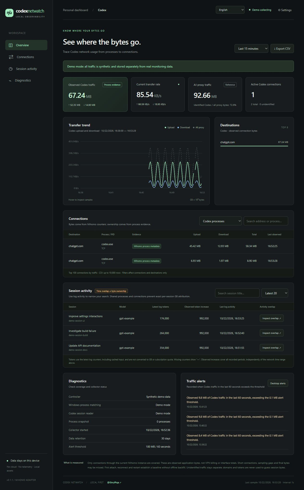

# Codex Netwatch

Local-first network observability for Codex. Uses **Mihomo connection counters** and **Windows socket/process evidence** to identify traffic, with read-only Codex session activity for diagnosis.

[中文 / full documentation](README.md) · [Contributing](CONTRIBUTING.md) · [Security](SECURITY.md)

[GitHub repository](https://github.com/GloryPkqa/codex-netwatch) · [Releases](https://github.com/GloryPkqa/codex-netwatch/releases)



## Quick start

Requires Windows 10/11, Node.js **24+**, and a running Mihomo/Clash Verge Rev instance. No npm install, API key, packet capture driver, HTTPS interception, or third-party runtime dependencies.

**Portable desktop option:** download `codex-netwatch-windows-x64.zip` from [Releases](https://github.com/GloryPkqa/codex-netwatch/releases), extract the full folder to a writable location and run `Codex-Netwatch.exe` to open the same dashboard inside a desktop window. It bundles a checksum-verified official Node runtime; no Node installation is needed. Requires .NET Framework 4.8 and Microsoft Edge WebView2 Runtime. Closing the window keeps collection running in the tray; double-click the tray to reopen it. The tray also offers browser access and collector controls. If WebView2 is missing, the window links to Microsoft's installer page and offers a browser fallback. The preview EXE is unsigned. See [portable build and lifecycle](docs/WINDOWS_PORTABLE.md).

- Double-click `start.cmd`, or run `npm start`.
- Dashboard: `http://127.0.0.1:43128`.
- Closing the page leaves collection running. Use **Settings → Stop monitor**, or Ctrl+C for a terminal instance.
- `start-demo.cmd` uses synthetic data on port 43129 and a separate database.
- The dashboard supports **English / 中文**. The top-right language selector defaults to **Auto (system)**: Chinese system languages use Simplified Chinese, all others use English. Windows reads the display language once at startup; if unavailable, the runtime locale is used. If the local language endpoint is unavailable, the browser's preferred language is the fallback. A manual selection is remembered in this browser; select Auto to follow the system again. Switching does not restart collection or clear filters.
- The footer's **@GloryPkqa** link opens this project's GitHub repository.
- `npm run doctor` prints a sanitised connectivity/process-matching report.

## Honest accounting

**Session activity is not session byte attribution.** Multiple chats may share processes and connections. This tool never allocates network GB according to tokens, hostname, or overlapping timestamps.

- Codex bytes require a named process from Mihomo, or an unambiguous source-address/port match against the Windows TCP/UDP owner table. Optional descendants are labelled separately.
- Hostnames are destinations, not application identity. Browser traffic to ChatGPT remains browser traffic.
- Network counters measure application bytes visible to the current Mihomo controller, not VPN billing or wire bytes. Direct traffic bypassing the controller is invisible.
- First attach, restart, controller switching, and reconnect establish a baseline. Historical/offline bytes are not imported.
- Snapshot sampling can miss entire short connections and final bytes before close. Global proxy totals may exceed per-connection observed totals.
- GB/MB use decimal units. Network ranges begin at the preceding minute boundary, matching minute-bucket connection aggregation.
- Custom historical end times are exclusive minute boundaries; non-minute API values round up to the next boundary. Connection activity timestamps stay within the queried range.
- Latest log token counters include cached input; reasoning/output details are not added twice. These are not final bills or subscription quotas. Missing data stays unknown.
- Session token increments cover observed runtime periods across restarts, independently of the network range selector. No offline token backfill.

## Configuration

The **Traffic investigation** panel persists upload/download bursts, sustained upload windows, the largest retained measured contributor, process totals, and collection gaps. Burst detection uses the configured decimal MB/60-second threshold. Sustained upload requires at least two minutes, average upload at least half that rate, and at least 75% of measured time above a quarter of that rate. Events rearm after recovery, with a five-minute cooldown. Context retains the leading 10 uploads and 10 downloads per sample; it does not attribute every window byte to the displayed connection. Gaps never invent offline bytes. Investigation summaries refresh within 10 seconds; normal live metrics remain separate.

**Settings → Export redacted diagnostics** downloads an allowlisted JSON report with versions, collector state, aggregate counters, resource measurements and SQLite health. It excludes secrets, paths, domains, IPs, process names/PIDs, session titles/IDs and log/chat/tool contents. Review the remaining runtime and usage summary before sharing.

See [stability validation](docs/STABILITY.md) for reproducible fault/load and 24–72-hour runs. A short smoke test does not establish 24-hour stability; reports record actual elapsed time and reject major scheduling pauses. The v0.2.0 preview begins a real 24-hour run, whose completion is reported separately.

Copy `config.example.json` to `config.local.json`. Restart after changes. Environment overrides: `CODEX_HOME`, `CODEX_FLOW_CONTROLLER`, `CODEX_FLOW_PORT`, `CODEX_FLOW_DATA_DIR`, `MIHOMO_SECRET`.

`CODEX_FLOW_DATA_DIR` is the real monitor's data directory; demos always use its `demo/` subdirectory. A collector lock prevents multiple processes (even on different ports) writing the same directory. Clean shutdown releases the lock. Only a verifiably dead PID's lock is automatically reclaimed; unknown locks require manual verification before removal.

Discovery supports local Clash Verge configuration and live Windows named-pipe enumeration, including mismatches between configured sidecar and actual production pipe names. Only local HTTP controllers / Windows pipes are allowed. The tool never changes proxy rules or controller settings.

The page can change the alert threshold. Browser desktop alerts require permission and an open page. Historical alert records remain visible without browser notification permission.

## Data and source distribution

Local SQLite stores observed connection destinations, process names/PIDs, session titles/IDs/models, token counts, activity times, and alerts. It does **not** persist chat contents, request bodies, tool outputs, command lines, or credentials. Session JSONL tails are read in memory to extract usage; Codex databases are opened read-only.

`data/`, `config.local.json`, and logs are ignored by Git. Review exported CSV before sharing. `scripts/package.ps1` creates an allowlisted source ZIP without user data, local configuration, or Git history. No automatic startup registration, remote telemetry, uploads, or GitHub publication.

## Development

```sh
npm run check
npm test
```

Native Node HTTP, SQLite, and browser APIs; no dependency installation. UI assets are entirely local. Windows helper uses IP Helper owner tables for IPv4/IPv6 TCP/UDP and periodically refreshes process ancestry, with PID-reuse checks. Linux/macOS can use controller-provided process metadata, but do not yet have a native socket adapter. CI runs on Windows and Linux.

Codex local schemas are internal and may change. Incompatible session data degrades to unavailable without disabling network collection. Latest 200 sessions are considered, with a cached, bounded 2 MB log tail per session.

See [related projects and positioning](docs/RELATED_PROJECTS.md) for overlapping network and token monitors. We do not claim this is the first or only tool in this category.

Independent project, not affiliated with OpenAI or MetaCubeX. [MIT license](LICENSE).
