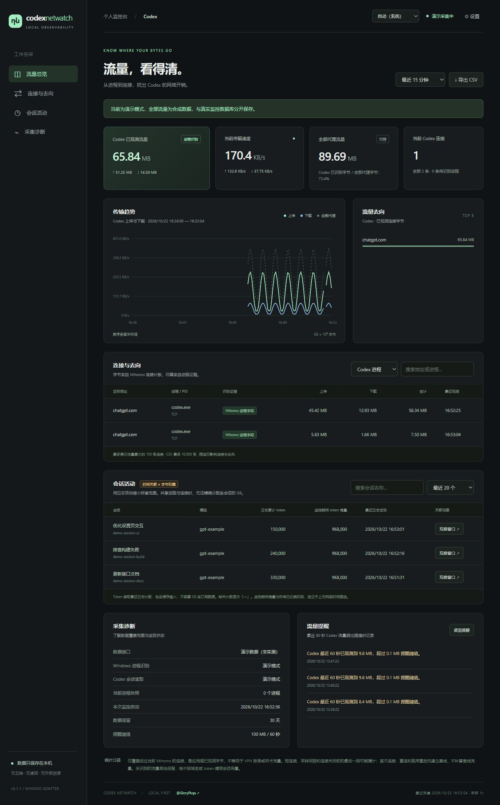

# Codex Netwatch

**在本机看清 Codex 的网络开销。** 通过 Mihomo 实测连接字节，用 Windows 套接字识别进程，并将 Codex 会话日志作为排查线索。

[English](README.en.md) · [贡献指南](CONTRIBUTING.md) · [安全与隐私](SECURITY.md) · [更新记录](CHANGELOG.md) · [同类项目比较](docs/RELATED_PROJECTS.md)

项目仓库：[GloryPkqa/codex-netwatch](https://github.com/GloryPkqa/codex-netwatch) · [预发布版本](https://github.com/GloryPkqa/codex-netwatch/releases)

> 当前版本：0.1.1。Windows 优先，独立于 Codex 运行，不是 OpenAI 官方工具。不调用 OpenAI API，不需要 API Key，不修改代理规则，不解密 HTTPS。



## 能做什么

- 实时查看 Codex 上传、下载、总量与速度，和全部代理流量作对照。
- 按目标地址、进程、PID、识别证据排查流量，区分 Codex、子进程、其他进程和待识别连接。
- 保存本地历史，支持 15 分钟 / 1 小时 / 24 小时 / 7 天 / 30 天 / 全部 / 自定义时间。
- 列出最近会话的日志活动和 token 计数，查看活动时间与采样时间重合情况。
- 支持最近 60 秒流量阈值提醒、可选浏览器桌面通知、CSV 导出。
- 自动发现 Clash Verge Rev 的本地控制接口，包括实际运行的 Windows 命名管道。
- 零第三方运行依赖，静态页面无外部字体、CDN 或遥测。演示数据使用单独数据库。

## 先了解统计口径

| 数据                | 含义                                                         | 限制                                                    |
| ------------------- | ------------------------------------------------------------ | ------------------------------------------------------- |
| Codex 已观测流量    | 有进程证据的连接字节增量                                     | 不是 VPN 账单，也不是网卡总字节                         |
| 全部代理流量        | 当前 Mihomo 全局上传 / 下载计数增量                          | 包含其他应用；不覆盖绕过此代理的流量                    |
| 待识别流量          | 连接已观测到，但缺少可靠的进程证据                           | 不按 ChatGPT 域名归为 Codex                             |
| 会话活动窗口        | 最近 60 秒有日志变化的会话与采样时间重合                     | **不表示流量属于该会话**                                |
| 日志累计 token      | 最近可读取的 `total_token_usage` 计数                        | 可能随日志格式 / 上下文重置变化；不是最终账单或订阅额度 |
| 监控期间 token 增量 | 同一程序运行中连续观测到的正向计数变化，跨运行保留已记录增量 | 不补算停止期间，不按网络时间筛选；首次读取不导入旧累计  |

**无法把共享连接的流量精确拆给每个会话。** 本项目不会按 token 比例、域名或时间重合虚构会话 GB。需要定位时，先观察进程 / 域名，再单独运行目标会话比较变化。

Mihomo `/connections` 是活动连接快照。采样间隔内建立又关闭的短连接、关闭前未采到的尾部字节可能漏计。首次接入、接口切换、重连和程序重启先建立基线，不补算之前的字节。全局代理计数通常比已观测连接增量更完整，二者不保证相等。**本项目不是完整抓包工具。**

## 开始使用（Windows）

要求：Windows 10/11、**Node.js 24 或更新版本**、正在运行的 Mihomo / Clash Verge Rev。Windows 自带 PowerShell 5.1 即可，无需管理员权限运行本工具；个别系统策略可能限制进程识别，此时保持「待识别」。

1. 启动代理，正常使用 Codex。
2. 双击 `start.cmd`。程序启动后自动打开 `http://127.0.0.1:43128`。
3. 等待「Windows 进程识别：正常」，再观察新产生的流量。
4. 关闭网页后后台继续采集；在页面 **设置 → 停止监控** 退出。

启动脚本优先使用 PATH 中的 Node，也兼容已有的 Codex 本地 Node 运行时。第一次运行会生成 `data/`。再次双击会打开已运行的实例，不重复启动。没有配置开机自启。

右上角支持 **中文 / English / 自动（系统）**。默认自动识别：中文系统使用简体中文，其他语言使用英文。Windows 在启动时读取显示语言；读取受限时使用运行时语言，无法取得本地接口时再回退浏览器首选语言。手动选择会保存在当前浏览器中，选择「自动（系统）」可恢复自动识别。切换即时生效，不重启采集、不清空筛选，也不翻译真实会话标题等原始数据。页脚 **@GloryPkqa** 直接打开项目仓库。

也可以在终端运行：

```powershell
npm start
# Ctrl+C 停止
```

如果你使用的是不带 npm 的现有 Codex Node 运行时，也可直接运行 `node --disable-warning=ExperimentalWarning src/main.mjs`。启动脚本不依赖 npm。

想先看合成数据：双击 `start-demo.cmd`，使用端口 `43129`，不会读取真实会话。`npm run demo` 默认仍使用 `43128`，与真实实例并行时需指定 `CODEX_FLOW_PORT=43129`。

## 配置

通常无需配置。需要时复制 `config.example.json` 为 `config.local.json`，修改后重启。该文件被 Git 忽略。

| 配置                 | 默认值     | 说明                                                       |
| -------------------- | ---------- | ---------------------------------------------------------- |
| `controller`         | `auto`     | 自动发现；也可填写 `http://127.0.0.1:9090` 或命名管道路径  |
| `port`               | `43128`    | 监控面板端口，只监听 `127.0.0.1`                           |
| `codexHome`          | `~/.codex` | 本机 Codex 数据目录；空字符串使用默认                      |
| `intervalMs`         | `1000`     | 采样周期，500–10000 毫秒                                   |
| `retentionDays`      | `30`       | 网络历史和提醒的保留天数，1–365；约每小时清理过期记录      |
| `alertMBPerMinute`   | `100`      | 60 秒已观测 Codex 字节的十进制 MB 阈值；页面保存的阈值优先 |
| `includeDescendants` | `true`     | 将 Codex 子进程的连接计入，并标记为「Codex 子进程」        |
| `processNames`       | 见示例     | 进程名精确匹配，忽略大小写，不进行模糊路径匹配             |

支持环境变量：`CODEX_HOME`、`CODEX_FLOW_CONTROLLER`、`CODEX_FLOW_PORT`、`CODEX_FLOW_DATA_DIR`、`MIHOMO_SECRET`。环境变量优先于本地配置。

`CODEX_FLOW_DATA_DIR` 指定真实监控的数据目录；演示模式始终使用其 `demo/` 子目录。每个数据目录同时只允许一个采集程序，改变端口也不会绕过此限制。正常停止自动释放 `collector.lock`；崩溃后只会自动回收可确认进程已退出的锁，无法确认的锁需先核实原实例确实停止后手动移除。

网络历史以分钟聚合：开始时间向下取整到分钟；历史结束时间为所选分钟边界、不包含该边界之后的数据。非整分钟的 API 结束值向上取整至下一分钟边界。页面显示实际查询范围，实时范围仍截止到当前时刻。

HTTP 接口需要密钥时，在启动程序的同一 PowerShell 中设置：

```powershell
$env:CODEX_FLOW_CONTROLLER = 'http://127.0.0.1:9090'
$env:MIHOMO_SECRET = '<你的本地控制接口密钥>'
npm start
```

自动发现还会从已安装 Clash Verge 的顶层控制配置读取 `secret`，只用于访问本机接口，不写入监控数据库或浏览器响应。仅支持本地 HTTP / 命名管道，拒绝远程地址。不会修改控制器的监听地址或代理设置。

## 排查问题

```powershell
npm run doctor
```

不带 npm 时使用 `node --disable-warning=ExperimentalWarning scripts/doctor.mjs`。

输出只包含本工具版本、运行平台、接口连通性和进程识别数量；不包含接口密钥、会话标题、目标域名或机器上的绝对路径。

- **接口未连接**：确认 Mihomo 正在运行；自动发现不适用时显式填写本地 `controller`。401/403 表示需要正确的 `MIHOMO_SECRET`。
- **总流量在增长，Codex 为 0**：查看「待识别进程」，并检查采集诊断。未走此代理的流量不可见；首次采样只是基线。
- **Mihomo 进程字段为空**：Windows 适配器会通过源地址 / 端口与系统 TCP / UDP 表匹配 PID；进程名由本机进程快照补充，不需要开启代理全局进程模式。
- **某个会话 token 是「—」**：最近 2 MB 日志尾部没有可读取计数，或该会话不在本机日志中；未知不当作零。
- **想统计独立工具下载**：默认计入仍可追溯为 Codex 子进程的下载；重挂到其他父进程的后台任务可能不可追溯。
- **端口冲突**：设置 `CODEX_FLOW_PORT`。日志在 `data/server.log` 与 `data/server-error.log`。
- **监控自己是否消耗代理流量**：采集和面板只访问本地接口，页面不加载外部资源；进程快照通过本地子进程管道传递。

## 隐私与发布

监控数据库包含目标地址、进程名 / PID、会话标题 / ID / 模型、token 计数、活动时间和提醒。不会保存请求正文、聊天正文、工具输出、进程命令行或认证文件。为提取计数会在内存中读取会话 JSONL 尾部，但只持久化上述统计字段。

程序会读取代理连接列表，所以数据库也可能包含其他应用的目标地址。请勿分享 `data/`、`config.local.json`、日志或未检查的 CSV。默认没有外部通信，但软件运行在你的用户权限下，不是隔离的安全沙箱。

准备发到 GitHub 时，使用源码包：

```powershell
powershell -NoProfile -ExecutionPolicy Bypass -File scripts/package.ps1
```

生成项目目录旁的 `codex-netwatch-source.zip`。打包使用显式文件白名单，**不包含本地配置、运行数据、日志或 Git 历史**。项目已提供 `.gitignore`、MIT 许可证、贡献指南及 Windows / Linux CI。仓库创建、远程推送和公开发布由你决定。

## 实现与维护

Node.js 原生 HTTP + `node:sqlite` + 原生前端，无安装依赖。Windows 网络观察器通过 `iphlpapi.dll` 读取 TCP / UDP 的 IPv4 / IPv6 表，不抓包；每秒更新套接字，每约 5 秒更新进程树。

```text
Mihomo /connections ─── 字节计数 ─┐
Windows socket / process ─ 证据 ─┼─ Accounting ─ SQLite ─ 本地 HTTP 面板
Codex 只读数据库 / 日志 ─ 活动 ─┘                 └ CSV / 提醒
```

```powershell
npm run check
npm test
```

测试覆盖基线、累计计数去重、计数器重置、断线、新旧连接、PID 重用、进程树循环、来源限制、时间范围、CSV 公式注入、存储清理及本地接口边界。CI 不读取真实用户日志或代理。

当前 Linux / macOS 可运行 HTTP 采集与面板，但 Windows 套接字适配器不可用，进程归属依赖 Mihomo 自身字段；不宣称完整跨平台支持。Codex 本地数据库和日志属于可变化的内部格式，不兼容时降级为会话信息不可用，网络采集仍可运行。日志只读取最近 200 个会话，每个会话最多读取 2 MB 尾部，并缓存未变动的文件。

后续方向：其他平台代理适配器、按分钟历史压缩、采集缺口可视化、具有明确进程证据时的独立 CLI 会话关联。变更计量口径必须同时更新文档和测试。

参考：[Mihomo API](https://wiki.metacubex.one/en/api/) · [Mihomo 本地控制接口](https://wiki.metacubex.one/en/config/general/) · [Codex 高级配置](https://learn.chatgpt.com/docs/config-file/config-advanced) · [GitHub Actions 官方示例](https://docs.github.com/en/actions/tutorials/create-an-example-workflow)

## 许可证

[MIT](LICENSE)。OpenAI、Codex、Mihomo 等名称属于各自所有者。本项目无官方隶属关系。
