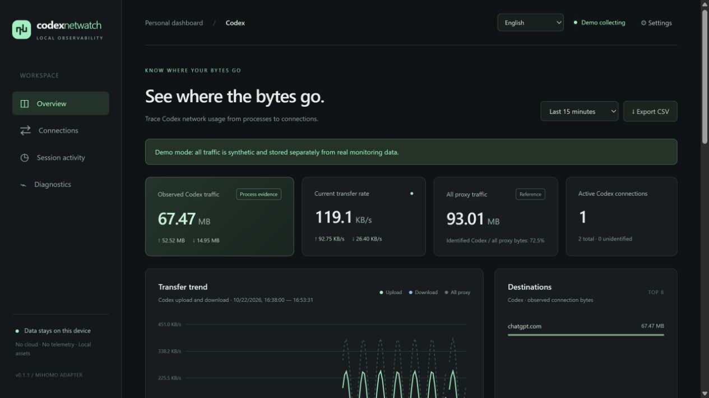

# Codex Netwatch

A local dashboard for Codex network usage, process attribution, and session activity.

[**Download for Windows x64 →**](https://github.com/GloryPkqa/codex-netwatch/releases/latest/download/codex-netwatch-windows-x64.zip) · [Release notes & checksums](https://github.com/GloryPkqa/codex-netwatch/releases/latest) · [简体中文](README.zh-CN.md)



**Windows first. Direct connections and proxies are supported.** Windows native capture records TCP/UDP process network events without requiring a proxy. A Mihomo / Clash-compatible controller remains an alternative. Choose **Automatic**, **Windows native**, or **Mihomo** in Settings; authorize the native helper when Windows requests administrator permission. Shared connections cannot be split precisely between chats.

## Features

- Daily/monthly traffic budgets, remaining usage, early warnings and the busiest recorded hours in the last 24 hours. Optional Windows tray budget alerts continue with the window closed.
- Live upload/download rates, local history, time filters (including the last 6 hours), and CSV export.
- Keep 1–365 days of network history, with a retention period you can change in Settings.
- Codex-only process rankings by default, with an explicit all-observed-process comparison.
- Windows ETW capture for direct TCP/UDP, IPv4/IPv6 and short-lived connections; automatic or manual source selection with no double counting.
- Upload/download burst detection, sustained-upload findings, and recorded collection gaps.
- Read-only session activity and token counters, kept separate from network bytes.
- Windows desktop GUI, system tray, optional startup at sign-in, and browser access.
- English by default. Select **中文** in the top-right language menu, or choose **Auto (system)**. Existing language preferences are remembered.
- Local SQLite storage, local UI assets, and redacted diagnostics; no application telemetry.
- First-run connection help distinguishes controller access, authentication, incompatible responses, and waiting for new Codex traffic. Reopen it from **Connection help** at any time.

[View the investigation panel](docs/investigation.en.png).

## Install on Windows

1. Download `codex-netwatch-windows-x64.zip` and `SHA256SUMS.txt` from the same [release](https://github.com/GloryPkqa/codex-netwatch/releases).
2. Verify the ZIP's SHA-256, then extract the **entire folder** to a writable location.
3. Run `Codex-Netwatch.exe` and Codex. A proxy is optional.
4. For direct capture, open **Settings → Authorize native capture** and accept Windows' administrator prompt. Automatic mode uses an authorized native helper, otherwise attempts Mihomo. Then make a new request in Codex.

```powershell
Get-FileHash .\codex-netwatch-windows-x64.zip -Algorithm SHA256
```

The portable build includes Node.js. It requires **Windows 10/11 x64, .NET Framework 4.8, and Microsoft Edge WebView2 Runtime**. The Windows EXE is unsigned.

Closing the window keeps collection running in the tray. Double-click the tray to reopen it. **Settings → Start with Windows** is optional and off by default. Use the tray's Exit command to quit the desktop host.

For updates, stop the app and back up `data/` and `config.local.json`. Replace application files while preserving both. See [portable lifecycle and build details](docs/WINDOWS_PORTABLE.md).

## Run from source

Install **Node.js 24+**. There are no JavaScript packages to install.

```powershell
git clone https://github.com/GloryPkqa/codex-netwatch.git
cd codex-netwatch
powershell.exe -NoProfile -ExecutionPolicy Bypass -File scripts/build-native.ps1
node --disable-warning=ExperimentalWarning src/main.mjs
```

Open [127.0.0.1:43128](http://127.0.0.1:43128). On Windows, `start.cmd` starts the collector and opens the browser; `start-demo.cmd` runs isolated synthetic data on port 43129. For a terminal instance, use Ctrl+C to stop collection.

## What the numbers mean

| Metric            | Meaning                                                                                                     |
| ----------------- | ----------------------------------------------------------------------------------------------------------- |
| Codex traffic     | Observed connection-byte deltas with process identity evidence. Other and unidentified traffic is excluded. |
| All observed traffic | Native process network events or the selected controller's global counters, including other apps.       |
| Session activity  | Log activity overlapping collection times; **not per-chat GB attribution**.                                 |
| Token counters    | Local log counters and observed increments; **not billing or subscription quota**.                          |

Native capture counts new events from helper startup and retains connections that close between dashboard polls. It includes loopback process traffic and shows destination IPs without DNS lookups. ETW buffer loss is recorded as a gap. Mihomo snapshots can miss short connections and closing bytes and establish a baseline on first attach/reconnect. Source changes mark gaps; historical totals can include different measurement methods. Offline traffic is not backfilled, and none of these counters is a VPN bill or interface total. MB and GB use decimal units. See [native capture details](docs/NATIVE_CAPTURE.md).

## Configuration and troubleshooting

In **Settings → Daily and monthly budgets**, enter decimal GB limits (0 disables a budget), an early-warning percentage and a scope: Codex only or all observed processes. The budget panel always shows the current calendar day/month, independently of the history filter. Each threshold warns once per limit, scope and period; a jump straight past 100% records the exceeded warning only. Changing a limit evaluates the recorded usage immediately. Enable budget desktop alerts to receive Windows tray balloons while the desktop host is running; OS notification settings can suppress delivery. Browser notification permissions are separate.

Budgets count uploads plus downloads that Netwatch recorded, including the active source's local-connection semantics. They do not measure a data-plan bill or subscription allowance and never block connections. The database fixes its calendar zone from the system on first budget upgrade; the panel displays it. Daily/monthly counters roll over at local midnight/the first day of the month in that zone. Daily aggregates survive detailed-history pruning and are retained until the data directory is removed. Existing retained samples are imported once; already-deleted or unobserved traffic is not recovered. **Version 0.4 upgrades the database to schema 4: back up `data/` before upgrading; use that backup if returning to an older version.**

Start with **Settings → Traffic capture source** and **Connection help**. Native capture requires administrator authorization for the helper each run, without elevating the dashboard or installing a service. Startup at sign-in does not automatically request elevation. Mihomo mode supports automatic discovery of supported local Clash Verge configurations and Windows named pipes. For manual proxy setup, use the **controller port**, not the HTTP / SOCKS proxy port.

In **Settings → Data retention**, enter how many days to keep and save. Your choice survives restarts and takes effect on the next successful collection. Shortening the period deletes older network records and alerts; extending it cannot bring deleted data back. Session-log token counters are separate from network history retention.

Copy `config.example.json` to `config.local.json`, edit it, then restart. Environment overrides include `CODEX_FLOW_CONTROLLER`, `MIHOMO_SECRET`, `CODEX_HOME`, `CODEX_FLOW_PORT`, and `CODEX_FLOW_DATA_DIR`.

```powershell
node --disable-warning=ExperimentalWarning scripts/doctor.mjs
```

[Configuration and troubleshooting](docs/CONFIGURATION.md) covers controller secrets, attribution, paths, and collection limits. **Settings → Export redacted diagnostics** creates a report without connection/session identities or credentials; review its aggregate usage before sharing.

## Privacy and validation

Local data includes destinations, process identity, session metadata, token counters, and activity times. Chat bodies, tool contents, command lines, and credentials are not persisted. Keep `data/`, local configuration and raw CSV private; inspect screenshots for sensitive information before choosing to share them. See [Security and privacy](SECURITY.md).

CI checks syntax and tests on Windows/Linux and builds/tests the Windows portable lifecycle. [Validation records](docs/VALIDATION.md) describe the exact tested scope. **A completed 24/72-hour validation is not claimed.**

## Development

```sh
npm run check
npm test
```

The collector uses Node.js HTTP and SQLite with a local HTML/CSS/JavaScript dashboard. The native helper uses Windows ETW with a private real-time network session and authenticated local named-pipe IPC; no drivers or packet payloads are collected. Windows process ancestry supplements event PIDs. Linux/macOS can use controller-supplied process metadata; native capture and the desktop EXE are Windows-specific.

[Contributing](CONTRIBUTING.md) · [Stability runner](docs/STABILITY.md) · [MIT license](LICENSE)

Maintained by [GloryPkqa](https://github.com/GloryPkqa). Independent project, not affiliated with OpenAI or MetaCubeX.
